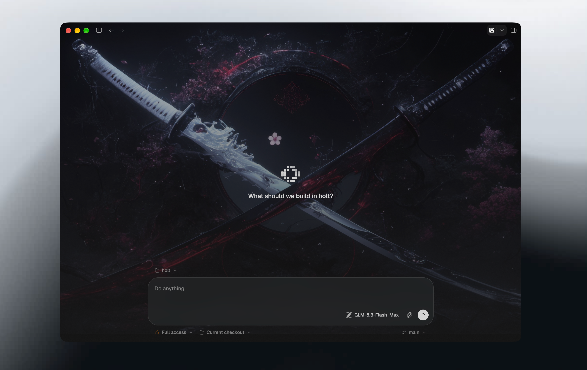

<p align="center">
  
</p>

<h1 align="center">Holt</h1>

<p align="center">
  A local coding agent that survives crashes and lets you rewind to any
  message.
</p>

<p align="center">
  English · <a href="README.zh-CN.md">简体中文</a>
</p>

<p align="center">
  <a href="LICENSE"></a>
  
</p>

<p align="center">
  
</p>

> [!WARNING]
> Holt is a work in progress — an experimental project under active
> development. Expect rough edges and breaking changes.

## Why Holt

Long tasks fail at the worst times. The build is two hours in, the agent is mid-run, and the app gets killed. Every other tool tells the model "it may have partly run" and starts over. Holt doesn't.

- **Survives crashes.** When the app is killed mid-run, Holt restores orphan processes, tells the model exactly which files changed since it started, and picks up the Turn automatically. The model sees what happened and decides whether to continue — it doesn't start from scratch.
- **Rewind to any message.** Every tool call that touches a file records the exact bytes before and after. If the agent goes off track, hover the message you want to return to and rewind — the conversation is trimmed and the files go back together, all or nothing.
- **Local only.** No cloud, no accounts, no sync, no telemetry. Chats, transcripts, credentials, and checkpoints live under `~/.holt` and nowhere else.
- **One process.** No daemon, no CLI. A native desktop app that embeds its backend in-process over a typed memory-RPC transport.

## Features

- **Crash recovery & Intent journal** — a Turn interrupted by `kill -9` or a crash resumes automatically on the next launch: orphan processes cleaned up, modified files reconciled, and the conversation picked up seamlessly.
- **Step checkpoints & Instant rewind** — every write, edit, and bash call records atomic, content-addressed file changes before and after. Hover any past message to preview and rewind the changes and conversation together — a Turn still running is interrupted for you.
- **Multi-agent Workflows & Subagents** (`/workflow`) — orchestrate background subagents with model-written JavaScript on embedded QuickJS (`agent()`, `parallel()`, `pipeline()`). Declares explicit plan graphs up front with an interactive spatial GPUI canvas (DAG with pan, zoom, expand, and live link animations), token tracking, and journal-backed resume caching.
- **Goal mode with independent verifier** (`/goal`) — set durable objectives that run autonomously across multiple turns. After each settled Turn, an independent verifier pass evaluates concrete evidence (file diffs, tool outputs) against the goal and automatically enqueues the next visible, editable step until complete.
- **Scheduled routines** — user- or agent-defined scheduled prompts (`schedule_routine`, cron expressions, or one-shot at specific dates/times), running in designated Spaces with automatic catch-up runs for missed schedules.
- **Isolated Session Worktrees** — spawn dedicated Git worktrees (`<data dir>/worktrees/<chat id>`) on demand, allowing agents to explore and make changes on isolated branches without touching your active working copy.
- **Permission modes & Safe gates** — choose per chat: confirm each change manually, run an automated model review pass, or grant full access. Reads are never gated, and out-of-project writes carry visible warning badges.
- **Plan mode** (`/plan`) — the agent inspects the workspace and formulates a structured implementation plan for review and approval before touching any files.
- **Provider mode & Bring your own keys** (`/provider`) — built-in support for 25+ providers (Anthropic, OpenAI, DeepSeek, Gemini, etc.), custom endpoints, model records, and autonomous catalog discovery ("Add with AI") with secure in-transcript API key entry.
- **Review every Turn** — per-Turn change sets with file diffs, stage/unstage status, branches, checkout diffs, history graph, and fetch powered by an embedded git2 backend.
- **Context & Token usage inspector** — real-time token breakdown (input, output, cache hit rate), context window occupancy gauge, system prompt inspector, and turn-by-turn context usage report.
- **Extensible toolset & Terminals** — skills from standard skill roots (`.agents/skills`, `~/.agents/skills`, `~/.holt/skills`), MCP servers over stdio/HTTP, pluggable web search (keyless Exa default, Bocha, Zhipu, Brave) with web fetch, background processes, and chat-owned interactive terminals.

## Install

Download the latest build for your platform from
[Releases](https://github.com/Onion-L/holt/releases/latest):

- **macOS** (Apple Silicon or Intel): signed and notarized DMG.
- **Windows** (x64 or ARM64): Setup installer or portable ZIP; currently unsigned.
- **Linux** (x64 or ARM64): AppImage.

Then open **Settings → Providers** and add an API key before starting a run.

### Build from source

Requires stable Rust (pinned in `rust-toolchain.toml`) on macOS, Windows, or
Linux. Linux builds also need the native gpui packages listed in
[`.github/workflows/ci.yml`](.github/workflows/ci.yml).

```bash
cargo run --release -p holt
```

Data lives under `~/.holt`; override with `HOLT_DATA_DIR`.

## Architecture

```
gpui UI ── in-memory RPC (ndjson envelopes) ── LocalEngine + core agent loop
```

The UI links `crates/engine` only to assemble the local backend at bootstrap;
no feature code calls backend logic. Everything else goes through the typed
contract in `crates/rpc`; `crates/engine` adapts `crates/core`
(`holt-core`) behind the `RpcService`
trait, so another backend can slot in without touching the UI.

| Crate | Role |
| --- | --- |
| `apps/holt` | The binary: logging setup + `holt_ui::run_app`. No CLI. |
| `apps/holt-runner` | Headless Turn runner for local eval harnesses through the RPC contract. |
| `crates/ui` | The gpui viewport (built on `gpui-kit`) — agent-agnostic, renders `MessagePart`s from `holt-doc`. |
| `crates/engine` | The backend adapter: agent loop, providers, credentials, git, skills, terminals, background processes, workflows. |
| `crates/core` | The agent core (`holt-core`): providers, streaming, agent loop, harness. MIT-licensed. |
| `crates/rpc` | The typed control plane: framing, dispatch, memory transport (`rpc::methods`). |
| `crates/proto` | Shared protocol and domain types. |
| `crates/doc` | Transcript and History wire types (`MessagePart`, `TranscriptFrame`). Data on disk is plain JSON/JSONL, owned by `crates/engine`. |
| `crates/theme`, `crates/syntax` | Theme library and syntax highlighting. |

See [ARCHITECTURE.md](ARCHITECTURE.md) for the full RPC contract and the design
decisions behind it.

## Development

```bash
cargo fmt --all --check
cargo check --workspace
cargo clippy --workspace --all-targets -- -D warnings
cargo test --workspace
```

## Contributing

See [CONTRIBUTING.md](CONTRIBUTING.md) — and please follow the
[Code of Conduct](CODE_OF_CONDUCT.md). Found a security issue? Report it
privately via [SECURITY.md](SECURITY.md).

## Credits

The beautiful UI comes from [comet](https://github.com/zeronsh/comet) ❤️
