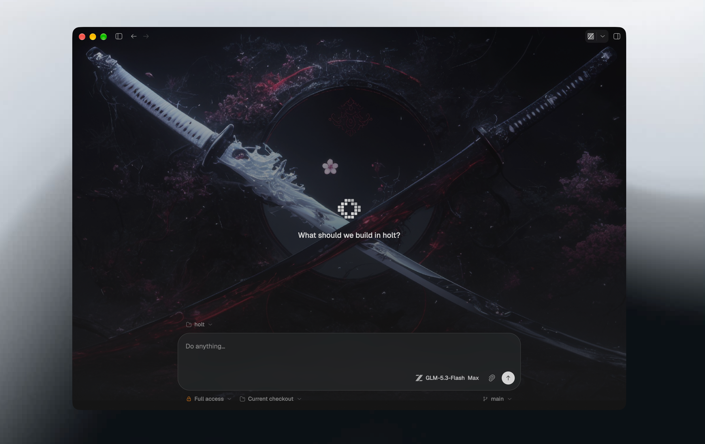

<p align="center">
  
</p>

<h1 align="center">Holt</h1>

<p align="center">
  A local coding agent that survives crashes and lets you rewind any step.
</p>

<p align="center">
  English · <a href="README.zh-CN.md">简体中文</a>
</p>

<p align="center">
  <a href="LICENSE"></a>
  
</p>

<p align="center">
  
</p>

> [!WARNING]
> Holt is a work in progress — an experimental project under active
> development. Expect rough edges and breaking changes.

## Why Holt

Long tasks fail at the worst times. The build is two hours in, the agent is mid-run, and the app gets killed. Every other tool tells the model "it may have partly run" and starts over. Holt doesn't.

- **Survives crashes.** When the app is killed mid-run, Holt restores orphan processes, tells the model exactly which files changed since it started, and picks up the Turn automatically. The model sees what happened and decides whether to continue — it doesn't start from scratch.
- **Rewind to any step.** Every tool call that touches a file records the exact bytes before and after. If the agent goes off track, hover any tool chip and rewind — the conversation is trimmed and the files go back together, all or nothing.
- **Local only.** No cloud, no accounts, no sync, no telemetry. Chats, transcripts, credentials, and checkpoints live under `~/.holt` and nowhere else.
- **One process.** No daemon, no CLI. A native desktop app that embeds its backend in-process over a typed memory-RPC transport.

## Features

- **Crash recovery** — a Turn interrupted by `kill -9` or a crash resumes automatically on the next launch: orphan processes cleaned up, the model told what changed, the conversation continued.
- **Step checkpoints** — every write, edit, and bash call records its exact file changes. Storage is content-addressed and bounded per chat; blobs older than the keep window are dropped and the object store is repacked.
- **Step rewind** — hover any resolved tool chip to preview and apply a rewind. The conversation is cut at that step, all parallel sibling calls included, and every file goes back to its state before the step. Conflicts — a file modified by something else since — block the whole rewind.
- **Bring your own model** — built-in providers plus custom providers and model records, editable live in Settings without a restart.
- **Permission modes** — per chat: confirm each change, let a model review pass judge it, or grant full access. Reads are never gated.
- **Plan mode** — the agent inspects the workspace and writes a plan for approval before touching anything.
- **Review every Turn** — per-Turn change sets with diffs, plus branches, checkout diffs, history, and fetch on a built-in git2 backend.
- **Extensible** — skills from the standard skill roots, MCP servers, subagents, and pluggable web search (Zhipu, Bocha, Brave).
- **Built-in terminals** — chat-owned terminal panes next to the transcript.

## Install

Grab the signed and notarized DMG for your Mac (Apple Silicon or Intel) from
[Releases](https://github.com/Onion-L/holt/releases/latest). macOS only for now.

Then open **Settings → Providers** and add an API key before starting a run.

### Build from source

Requires macOS and stable Rust (pinned in `rust-toolchain.toml`).

```bash
cargo run --release -p holt
```

Data lives under `~/.holt`; override with `HOLT_DATA_DIR`.

## Architecture

```
gpui UI ── in-memory RPC (ndjson envelopes) ── LocalEngine + core agent loop
```

The UI links `crates/engine` only to assemble the local backend at bootstrap;
no feature code calls backend logic. Everything else goes through the typed
contract in `crates/rpc`; `crates/engine` adapts `crates/core`
(`holt-core`) behind the `RpcService`
trait, so another backend can slot in without touching the UI.

| Crate | Role |
| --- | --- |
| `apps/holt` | The binary. No CLI. |
| `crates/ui` | The gpui viewport — agent-agnostic, renders `MessagePart`s from `holt-doc`. |
| `crates/engine` | The backend adapter: agent loop, providers, credentials, git, skills, terminals. |
| `crates/core` | The agent core (`holt-core`): providers, streaming, agent loop, harness. Holt-owned Rust port of pi v0.84.4. |
| `crates/rpc` | The typed control plane: framing, dispatch, memory transport. |
| `crates/proto` | Shared protocol and domain types. |
| `crates/doc` | Transcript and History wire types (`MessagePart`, `TranscriptFrame`). Data on disk is plain JSON/JSONL, owned by `crates/engine`. |
| `crates/theme`, `crates/syntax` | Theme library and syntax highlighting. |

See [ARCHITECTURE.md](ARCHITECTURE.md) for the full RPC contract and the design
decisions behind it.

## Development

```bash
cargo fmt --all --check
cargo check --workspace
cargo clippy --workspace --all-targets -- -D warnings
cargo test --workspace
```

## Contributing

See [CONTRIBUTING.md](CONTRIBUTING.md) — and please follow the
[Code of Conduct](CODE_OF_CONDUCT.md). Found a security issue? Report it
privately via [SECURITY.md](SECURITY.md).

## Credits

The beautiful UI comes from [comet](https://github.com/zeronsh/comet) ❤️
