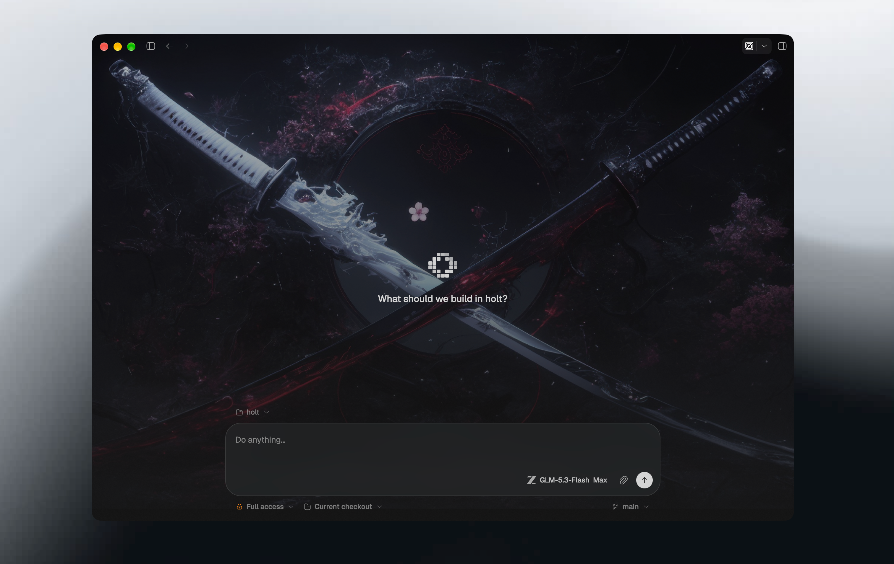

<p align="center">
  
</p>

<h1 align="center">Holt</h1>

<p align="center">
  本地 coding agent，崩溃后自动续跑，可回退到任意一条消息。
</p>

<p align="center">
  <a href="README.md">English</a> · 简体中文
</p>

<p align="center">
  <a href="LICENSE"></a>
  
</p>

<p align="center">
  
</p>

> [!WARNING]
> Holt 仍在开发中，是一个快速迭代的实验性项目。可能存在不完善之处，也可能出现不兼容的变更。

## 为什么是 Holt

长任务总在最糟糕的时候失败。构建跑了两个小时，agent 正在执行，app 被杀掉了。其他工具只会告诉模型"可能执行了一部分"然后重来。Holt 不一样。

- **崩溃后续跑。** app 被 kill -9 时，Holt 清理孤儿进程，告诉模型自它开始后哪些文件发生了变化，然后自动接着跑这个 Turn。模型知道发生了什么，自己决定怎么继续——而不是从头开始。
- **回退到任意一条消息。** 每个改过文件的工具调用都记录了改前和改后的精确字节。agent 跑偏了，在想回到的那条消息上悬停点击回退——对话被截断，文件一起回去，要么全做要么不做。
- **完全本地。** 没有云端、账号、同步，也没有遥测。对话、transcript、凭据和 checkpoint 只存放在 `~/.holt` 下。
- **单一进程。** 没有 daemon，也没有 CLI。原生桌面应用，后端通过类型化的内存 RPC 传输嵌在同一进程内。

## 功能

- **崩溃恢复与意图日志**——被 `kill -9` 或崩溃中断的 Turn 在下次启动时自动续跑：清理孤儿进程，对齐变更文件，无缝恢复对话。
- **步骤 checkpoint 与即时回退**——每个 write、edit、bash 调用都记录精确、基于内容寻址的文件改动前后状态。在任意一条历史消息上悬停，即可预览并回退改动与对话；正在运行的 Turn 会被自动中断。
- **多 Agent 工作流与 Subagent**（`/workflow`）——通过内嵌 QuickJS 执行模型编写的 JavaScript 脚本编排后台 Subagent（`agent()`、`parallel()`、`pipeline()`）。支持预先声明计划图，提供原生 GPUI 交互式拓扑画布（DAG 画布支持平移、缩放、展开以及实时数据流动画）、Token 消耗追踪与断点缓存复用。
- **带独立验证器的 Goal 目标模式**（`/goal`）——设定持久化目标并跨多个 Turn 自主循环执行。每个 Turn 结束后，独立验证器基于确凿证据（文件 diff、工具输出）评估目标完成度，并自动生成直观可编辑的下一步队列。
- **定时任务与例程**——支持用户或 Agent 设定计划任务（`schedule_routine`、Cron 表达式或单次定时），归属于指定 Space，并在应用休眠或唤醒后自动进行 Catch-up 补跑。
- **隔离的 Session Worktree**——按需生成独立的 Git worktree（`<data dir>/worktrees/<chat id>`），让 Agent 在独立分支上探索和修改，完全不影响主工作区。
- **权限模式与安全防护**——按对话设置：手动逐项确认、模型自动审查（Auto-review）或完全访问权限。读操作始终免审批，项目工作区外的文件写入会带有醒目的警告徽标。
- **Plan 规划模式**（`/plan`）——Agent 在动手改动前先检查工作区并生成结构化规划方案，经用户审核批准后再开始执行。
- **自带模型与 Provider 模式**（`/provider`）——内置支持 25+ 主流服务商（Anthropic、OpenAI、DeepSeek、Gemini 等），支持自定义端点与模型记录，并提供“AI 辅助添加”自主目录发现与对话内安全的 API Key 录入。
- **逐 Turn 变更集与内置 Git**——每个 Turn 的改动均生成变更集与清晰的文件 diff；内置 git2 后端，支持暂存/未暂存对比、分支切换、历史图谱和 fetch。
- **上下文与 Token 监控**——实时展示 Token 细分指标（输入、输出、缓存命中率）、上下文窗口占用率、完整系统 Prompt 检查器以及逐 Turn 上下文使用报告。
- **可扩展工具集与内置终端**——支持标准 Skills 目录（`.agents/skills`、`~/.agents/skills`、`~/.holt/skills`）、基于 stdio/HTTP 的 MCP 服务器、可切换网页搜索（默认免 Key Exa、博查、智谱、Brave）与网页抓取、后台进程管理及会话内嵌终端。

## 安装

从 [Releases](https://github.com/Onion-L/holt/releases/latest) 下载对应平台的安装包：

- **macOS**（Apple Silicon 或 Intel）：已签名并经过公证的 DMG。
- **Windows**（x64 或 ARM64）：Setup 安装程序或便携 ZIP，目前未签名。
- **Linux**（x64 或 ARM64）：AppImage。

开始运行前，先在 **Settings → Providers** 中添加 API key。

### 从源码构建

在 macOS、Windows 或 Linux 上安装 stable Rust（版本已在
`rust-toolchain.toml` 中固定）。Linux 还需要安装
[`.github/workflows/ci.yml`](.github/workflows/ci.yml) 中列出的 gpui 原生依赖。

```bash
cargo run --release -p holt
```

数据存放在 `~/.holt`，可通过 `HOLT_DATA_DIR` 修改。

## 架构

```
gpui UI ── in-memory RPC (ndjson envelopes) ── LocalEngine + core agent loop
```

UI 只在启动时链接 `crates/engine` 来组装本地后端，功能代码不直接调用后端逻辑。其余通信都走
`crates/rpc` 中的类型化协议；`crates/engine` 在 `RpcService` trait 后面适配
`crates/core`（`holt-core`），因此替换成其他后端时不需要改动 UI。

| Crate | 职责 |
| --- | --- |
| `apps/holt` | 可执行程序，没有 CLI。 |
| `apps/holt-runner` | 用于本地评测 Harness 的无头 Turn 运行器，通过 RPC 协议交互。 |
| `crates/ui` | gpui 视图层（基于 `gpui-kit` 构建），与具体 agent 无关，负责渲染 `holt-doc` 中的 `MessagePart`。 |
| `crates/engine` | 后端适配层：agent loop、provider、凭据、git、skills、终端、后台进程、工作流。 |
| `crates/core` | Agent 核心（`holt-core`）：provider、流式传输、agent loop、harness。MIT 授权开源。 |
| `crates/rpc` | 类型化控制面：分帧、分发、内存传输（`rpc::methods`）。 |
| `crates/proto` | 共享的协议类型和领域类型。 |
| `crates/doc` | Transcript 和 History 的传输类型（`MessagePart`、`TranscriptFrame`）。磁盘上的数据是普通 JSON/JSONL，由 `crates/engine` 负责。 |
| `crates/theme`、`crates/syntax` | 主题库和语法高亮。 |

完整的 RPC 协议及其背后的设计决策见 [ARCHITECTURE.md](ARCHITECTURE.md)。

## 开发

```bash
cargo fmt --all --check
cargo check --workspace
cargo clippy --workspace --all-targets -- -D warnings
cargo test --workspace
```

## 贡献

请阅读 [CONTRIBUTING.md](CONTRIBUTING.md)，并遵守[行为准则](CODE_OF_CONDUCT.md)。发现安全问题？请通过
[SECURITY.md](SECURITY.md) 私下报告。

## 致谢

漂亮的 UI 来自 [comet](https://github.com/zeronsh/comet) ❤️
